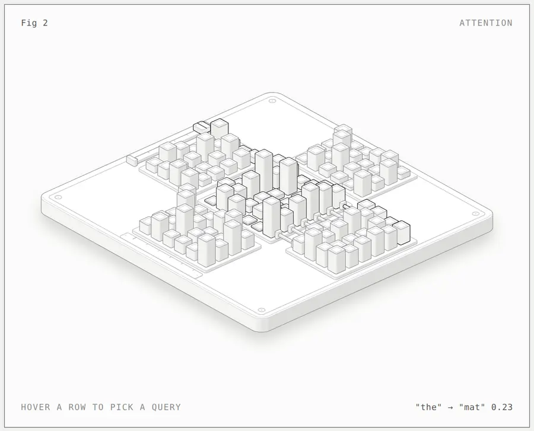
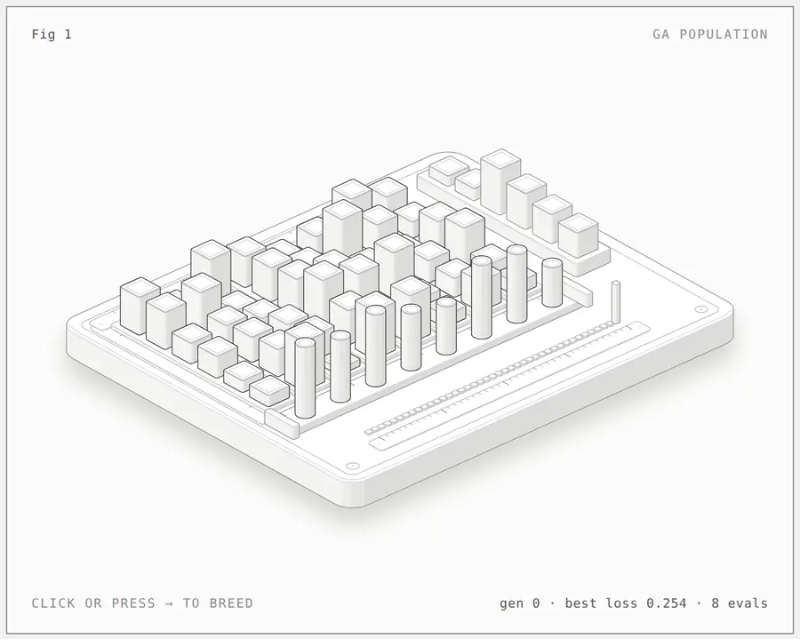

<h1 align="center">Schematic</h1>

<p align="center"><b>A Claude skill that explains a concept by building its own structure, exactly, as a crafted isometric object.</b><br>Also runs in OpenCode and Codex.<br>Tensors, attention heads, trees, hash tables, graphs and loss surfaces: every element at its true count, on a datum plate with index rulers, in SVG, WebGL and 3D.</p>

<p align="center">
  <a href="https://code.claude.com/docs/en/skills"></a>
  <a href="https://agentskills.io"></a>
  <a href="LICENSE"></a>
  <a href="#requirements"></a>
  <a href="#requirements"></a>
  <a href="https://github.com/ochlodeep/anatomy-schematic/actions/workflows/ci.yml"></a>
</p>

<p align="center">
  <a href="https://github.com/ochlodeep/anatomy-schematic/archive/refs/heads/main.zip"></a>
  &nbsp;
  <a href="#install"></a>
</p>

<p align="center">
  <a href="#quick-start">Quick start</a> ·
  <a href="#gallery">Gallery</a> ·
  <a href="#what-it-makes">What it makes</a> ·
  <a href="#install">Install</a> ·
  <a href="#usage">Usage</a> ·
  <a href="#examples">Examples</a> ·
  <a href="#how-it-works">How it works</a> ·
  <a href="#limits">Limits</a>
</p>

<p align="center">
  
</p>

<p align="center"><sub><code>examples/attention</code>, light theme. Every cube is one number from the model; the lit row is the chosen query's path.</sub></p>

---

Ask Claude for a figure that explains a technical concept, and Schematic has it draw the concept's own structure: a 6 × 6 attention score grid fed by Q and Kᵀ, a population of gene rows that sink and rise each generation, a hash table's buckets with their chains stacked in them. Every element is real and counted, heights carry true values, and structures that share an index line up along a shared ruler.

Then Claude builds that structure from small, solid, shaded parts on precise scaffolding (a datum plate on feet, index rulers, trays, tracks, ports), puts it in a framed card with a title, a hint and a live readout, makes it run its algorithm calmly under the pointer and the keyboard, and checks its own work by zooming in. Every number the figure shows comes from the same small model that shapes its parts.

Schematic is a fork of [Anatomy](https://github.com/wheresryan22/anatomy), which explains ideas by inventing a physical machine for them (a pin-tumbler lock for a cache key, a gantry plotter for a shared GPU context). Use Anatomy when a machine metaphor explains the idea best, and Schematic when the structure itself does.

## Quick start

```sh
npx skills add ochlodeep/anatomy-schematic -g -a claude-code
```

Then, in Claude Code:

```text
/schematic explain scaled dot-product attention for six tokens, interactive
```

For OpenCode or Codex, swap the agent: `-a opencode` or `-a codex`. OpenCode takes the same `/schematic` command; in Codex, type `$schematic`.

That's it. No API keys and nothing to `npm install`: the kit uses only Node's built-in modules.

## Gallery

<table>
  <tr>
    <td width="50%"></td>
    <td width="50%"></td>
  </tr>
  <tr>
    <td><sub><b>ga-population</b>: each generation the worst four rows sink and children rise in their slots, mutated genes lit. Click or press → to breed.</sub></td>
    <td><sub><b>attention</b>: hover a row to pick a query. Its Q row, softmax weights, conduit and output row light. <code>--audit</code> proves the conduits.</sub></td>
  </tr>
  <tr>
    <td></td>
    <td></td>
  </tr>
  <tr>
    <td><sub><b>raptor-engine</b> (from Anatomy): the kit reference for dense conduits, the audit, exploded views and WebGL inside the drawing.</sub></td>
    <td><sub><b>dial-indicator</b> (from Anatomy): the smallest kit reference, about 300 lines; the datum plate and rulers come from it.</sub></td>
  </tr>
</table>

Every screenshot is the light theme of a page in [`examples/`](examples), captured with the skill's own [`scripts/capture.mjs`](scripts/capture.mjs). The built pages are committed: open any `.html` in `examples/` to try it.

## What it makes

Three kinds of figure. All three share one kit, one camera and one set of craft rules.

| Kind | What it is | Example |
|---|---|---|
| **SVG** | The core. The concept's elements as solid isometric parts with four-tone shading, painted back to front on a datum plate, in a card with a live readout and eased motion. It ships as a standalone HTML page, a lone `.svg` file with its styles embedded, or React/Next.js components. | `ga-population`, `attention` |
| **SVG + WebGL** | For what lines can't draw on the structure: heat or density spreading over a surface, a glow along a conduit, light through a layer. The shader runs in a canvas between a back and a front SVG, in the figure's own isometric camera. The SVG still reads without WebGL. | `raptor-engine` (kit reference) |
| **3D** <sup>beta</sup> | Structures that turn in true 3D, to show a third axis or a lattice from every side. The moving parts are re-projected and re-shaded by the kit's own rules every frame. | `turning-dial` (kit reference) |

Each figure is light or dark. Light is the theme the skill designs for first.

## Install

Schematic is a standard [Agent Skill](https://agentskills.io): a folder with a `SKILL.md` at its root. This repository is that folder, and its skill is named `schematic`, so install it into a folder named `schematic`. Pick one way in:

| | Command | Installs to |
|---|---|---|
| **skills CLI**, for you (Claude Code) | `npx skills add ochlodeep/anatomy-schematic -g -a claude-code` | `~/.claude/skills/schematic` |
| **skills CLI**, for you (OpenCode) | `npx skills add ochlodeep/anatomy-schematic -g -a opencode` | `~/.config/opencode/skills/schematic` |
| **skills CLI**, for you (Codex) | `npx skills add ochlodeep/anatomy-schematic -g -a codex` | `~/.agents/skills/schematic` |
| **skills CLI**, for one project | `npx skills add ochlodeep/anatomy-schematic` | `.claude/skills/schematic` for Claude Code, `.agents/skills/schematic` for OpenCode and Codex |
| **git**, for you (Claude Code) | `git clone https://github.com/ochlodeep/anatomy-schematic.git ~/.claude/skills/schematic` | `~/.claude/skills/schematic` |
| **git**, for you (OpenCode) | `git clone https://github.com/ochlodeep/anatomy-schematic.git ~/.config/opencode/skills/schematic` | `~/.config/opencode/skills/schematic` |
| **git**, for you (Codex) | `git clone https://github.com/ochlodeep/anatomy-schematic.git ~/.agents/skills/schematic` | `~/.agents/skills/schematic` |
| **git**, for one project | `git clone https://github.com/ochlodeep/anatomy-schematic.git .claude/skills/schematic` | `.claude/skills/schematic` (Claude Code and OpenCode) or `.agents/skills/schematic` (OpenCode and Codex) |
| **Download**, no git | see below | any of the folders above |

Schematic and Anatomy install side by side: they are separate skills with separate names.

<details>
<summary><b>With the skills CLI</b></summary>

<br>

The [`skills`](https://github.com/vercel-labs/skills) CLI finds the `SKILL.md` at the root of this repository and installs it as `schematic`. By default it installs into the current project and asks which agents to set up. `-g` installs it for your user, and `-a claude-code` sets up Claude Code only. Use `-a opencode` or `-a codex` for OpenCode or Codex only.

The CLI copies the whole repository, examples included. It needs a recent Node.js: version 1.7.1 of the CLI asks for 22.20 or later.

</details>

<details>
<summary><b>With git</b></summary>

<br>

Clone the repository into one of the skill folders, so that `SKILL.md` ends up at `<skills folder>/schematic/SKILL.md`. For Claude Code use `~/.claude/skills/schematic` or `.claude/skills/schematic`. For OpenCode use `~/.config/opencode/skills/schematic` or `.opencode/skills/schematic`; OpenCode also reads the Claude Code and `.agents` folders. For Codex use `~/.agents/skills/schematic` or `.agents/skills/schematic`. For a project install, commit the folder so your team gets it too. To update later, `git pull` inside that folder.

</details>

<details>
<summary><b>Download, without git</b></summary>

<br>

[Download the ZIP](https://github.com/ochlodeep/anatomy-schematic/archive/refs/heads/main.zip), unpack it, rename the folder from `anatomy-schematic-main` to `schematic`, and move it into `~/.claude/skills/` (Claude Code), `~/.config/opencode/skills/` (OpenCode) or `~/.agents/skills/` (Codex).

Or in one line on macOS or Linux:

```sh
mkdir -p ~/.claude/skills/schematic && curl -L https://github.com/ochlodeep/anatomy-schematic/archive/refs/heads/main.tar.gz | tar -xz --strip-components=1 -C ~/.claude/skills/schematic
```

For OpenCode or Codex, put the same files in `~/.config/opencode/skills/schematic` or `~/.agents/skills/schematic`:

```sh
mkdir -p ~/.config/opencode/skills/schematic && curl -L https://github.com/ochlodeep/anatomy-schematic/archive/refs/heads/main.tar.gz | tar -xz --strip-components=1 -C ~/.config/opencode/skills/schematic
```

</details>

Claude Code picks up new skills in a running session. If the `skills` folder itself did not exist when the session started, run `/reload-skills`. OpenCode lists it as `/schematic` in its TUI; restart OpenCode if it does not show. Codex lists it under `/skills` and runs it with `$schematic`; restart Codex if it does not show.

<details>
<summary><b>Codex: if the browser checks are blocked</b></summary>

<br>

The skill checks its own figures by starting headless Chrome, which writes a temporary profile and talks to it over a local port. Codex runs commands in a sandbox, and that sandbox may stop Chrome. The figure is still built; only its checks fail. In order of preference:

1. When Codex asks to run a check outside the sandbox, approve it for that command. This needs the default `approval_policy = "on-request"`.
2. Or allow it once in `~/.codex/config.toml`:

   ```toml
   approval_policy = "on-request"
   sandbox_mode = "workspace-write"

   [sandbox_workspace_write]
   network_access = true
   writable_roots = ["/tmp"]
   ```

   Newer Codex releases may name these settings differently; check the config reference for your version.
3. Or run the check yourself in a normal terminal, for example `node scripts/capture.mjs page.html --out shots/page.png`.

Starting Codex with `--sandbox danger-full-access` also works, but it lifts every limit for that session, so keep it for projects you trust.

</details>

## Usage

Type `/schematic` (in Codex, `$schematic`) and say what the figure should explain:

```text
/schematic explain scaled dot-product attention for six tokens, interactive
```

You don't have to name the skill. Claude also loads it when you ask for an isometric or "premium" figure of a data structure, an algorithm, a model or a matrix, or ask to see the structure itself rather than a metaphor. OpenCode and Codex do the same.

<details>
<summary><b>More prompts</b>, from the skill's <a href="evals/evals.json">evals</a></summary>

<br>

```text
/schematic a figure for my blog showing how inserting 7 keys into a binary search tree builds it, one insert at a time. Single HTML file, white background.
```

```text
/schematic a hash table with 8 buckets and separate chaining: insert 12 keys and show the collisions stacking up, then a resize to 16 buckets. Dark theme, standalone HTML.
```

```text
/schematic gradient descent on a 2D loss surface, with a learning-rate control, for a light-themed course page. One HTML file.
```

```text
/schematic a React component for our Next.js docs showing a message queue with three consumers: messages are enqueued, delivered, acknowledged and retried. Plus a static HTML preview, dark theme.
```

</details>

Three habits get the best figures:

1. **Name the concept and its true sizes.** Say what it should explain and give the real shapes and counts (6 tokens with d = 4, 8 buckets, 12 keys). Small true sizes beat large vague ones: every element gets drawn.
2. **Say which operation to show.** A structure at rest is half the story: an insert, a lookup, a generation, a step of descent is the other half.
3. **Say where it will live.** A standalone HTML page, a lone SVG file, or a React/Next.js component; light or dark. The build differs for each.

A figure arrives as source you own: a model module, a Node build script and the page it writes, or, for React, geometry modules, a server component for the static art and one client component for the motion. The kit comes with it.

## Examples

Each framework-free example has a Node build script that writes standalone pages next to itself. Add `--light` for the light theme.

| Example | What it shows | Build |
|---|---|---|
| [`ga-population`](examples/ga-population) | A genetic algorithm's population: 8 rows of 6 gene cubes on trays beside a target row on a plinth. Each generation the worst 4 rows sink and children rise in their slots with mutated genes lit; loss pins stand on a track and a strip records the best loss per generation. Rebuilds its cells live with `schemaScript()`. | `node examples/ga-population/build.mjs` |
| [`attention`](examples/attention) | Scaled dot-product attention for 6 tokens with d = 4: the softmax score grid with Q, Kᵀ, V and the output grid around it, rows joined to the output by conduits. A carriage picks the query and lights its path. 150 solids and 6 conduits, proved by `--audit`. | `node examples/attention/build.mjs` |
| [`dial-indicator`](examples/dial-indicator) | Kit reference from Anatomy: a dial gauge on a stand over a carriage of gauge blocks. The smallest figure, about 300 lines. | `node examples/dial-indicator/build.mjs` |
| [`raptor-engine`](examples/raptor-engine) | Kit reference from Anatomy: a Raptor 2 engine in a test stand that comes apart into 11 assemblies, with a WebGL plume. The reference for dense conduits, smooth shading, fades and the audit. The build takes a few minutes. | `node examples/raptor-engine/build.mjs` |
| [`test-rig`](examples/test-rig) | Kit reference from Anatomy: a production React/Next.js figure, the reference for the server/client split. No build script: copy it into a React app. | none |
| [`turning-dial`](examples/turning-dial) | Kit reference from Anatomy: the 3D mode, a combination dial that turns in true 3D with a small robot hand on it. | `node examples/turning-dial/build.mjs` |

`node examples/attention/build.mjs --audit`, `node examples/raptor-engine/build.mjs --audit` and `node examples/turning-dial/build.mjs --light --audit` also run the geometry audit. The 3D audit is slow; see [`references/3d.md`](references/3d.md).

## How it works

- **[`SKILL.md`](SKILL.md)** is what Claude reads. It sets the workflow: collect the true numbers first, choose the native form, write the structure list, plan the world, build the geometry once with the kit, paint back to front, frame it, make it live, and then verify it like a critic. It also holds the craft rules in short form.
- **[`kit/`](kit)** is the drawing library the figures are built from: the native-structure primitives (`schema.mjs`: datum, rulers, cells, grids, columns, stacks, nodes, conduits, tracks, height fields), the isometric camera, solids and a parts library (`iso-kit`), round parts on any axis (`lathe.mjs`), conduits (`tube.mjs`), the WebGL layer (`gl.mjs`), the 3D runtime (`turn*.mjs`), and React components (`react/`). Apart from React for those components, it has no dependencies.
- **[`references/`](references)** are the long-form guides Claude opens when it needs them: the concept-to-form idiom, craft, the schema and kit APIs, motion, React, verification, WebGL, design walkthroughs and the 3D mode.
- **Verification.** [`kit/audit.mjs`](kit/audit.mjs) proves the geometry: nothing passes through anything, every conduit end sits on a port or rim, everything is supported, and every overlap is drawn in depth order (`node build.mjs --audit`). In headless Chrome, [`scripts/capture.mjs`](scripts/capture.mjs) and [`scripts/drive.mjs`](scripts/drive.mjs) take screenshots, close-ups and slowed-down contact sheets, [`scripts/lines.mjs`](scripts/lines.mjs) fails any line that ends in mid-air, and [`scripts/turn-check.mjs`](scripts/turn-check.mjs) checks 3D figures. The skill tells Claude to read every PNG it makes and to count the elements against the model.

<details>
<summary><b>Repository layout</b></summary>

<br>

```text
schematic/
├── SKILL.md                  the skill: workflow, setup and craft rules
├── kit/                      the drawing library
│   ├── schema.mjs            native-structure primitives: datum, rulers, cells, grids, stacks, nodes, conduits, tracks, surfaces
│   ├── iso-kit.ts            the core: camera, solids, parts, SVG renderer, card and page, CSS
│   ├── iso-kit.mjs           the same core as plain ESM, for Node build scripts
│   ├── iso.css               the kit's CSS, both themes
│   ├── react/                draw.tsx (server-safe components), live.tsx (client hooks)
│   ├── lathe.mjs             round parts on any axis
│   ├── tube.mjs              conduits, pipes and cables
│   ├── audit.mjs             the geometry audit
│   ├── gl.mjs                the WebGL layer for shaders inside the drawing
│   ├── turn.mjs              the 3D runtime (beta)
│   ├── turn-build.mjs        the 3D builder
│   ├── turn-audit.mjs        the 3D orbit audit
│   └── turn-fixed.mjs, canvas-painter.mjs, gl-shared.mjs
│                             experimental variants, not yet documented or used by the examples
├── references/               long-form guides Claude reads as needed
│   ├── idiom.md  schema.md  craft.md  kit.md  motion.md
│   └── react.md  verify.md  webgl.md  walkthrough.md  3d.md
├── scripts/                  headless Chrome checks and build helpers
│   ├── capture.mjs           screenshots and close-ups
│   ├── drive.mjs             scripted sessions and contact sheets
│   ├── lines.mjs             the line-end check (with line-ends.mjs)
│   ├── inline-kit.mjs        the kit and schema as source, to inline into a standalone page
│   ├── turn-check.mjs        3D checks in the browser (with turn-fidelity.mjs)
│   └── turn-bench.mjs        3D timing in Node
├── examples/                 two native figures and four kit references, built pages committed
├── evals/evals.json          test prompts and what a good answer contains
└── .github/                  issue forms, PR template, CI, README images
```

</details>

## Requirements

| | Needed for | Notes |
|---|---|---|
| **[Claude Code](https://code.claude.com/docs/en/overview)**, or [OpenCode](https://opencode.ai/docs/skills/) or [Codex](https://developers.openai.com/codex/skills) | everything | The skill is written for Claude Code and follows the open Agent Skills format, so OpenCode and Codex load it too. In Codex, the browser checks start Chrome; if its sandbox blocks that, allow it for those commands. |
| **Node.js 20.10+** | builds, kit, checks | Built-in modules only: nothing to `npm install`. On Node 20 the browser scripts restart themselves with `--experimental-websocket`. |
| **Chrome or Chromium** | the checks | `capture.mjs`, `drive.mjs`, `lines.mjs` and `turn-check.mjs` look in the usual places on macOS, Linux and Windows and in Playwright's cache. Set `CHROME_PATH` for any other binary. They run it headless with WebGL on. |
| **React 18+** | React output only | `kit/react/` and `examples/test-rig/`. |

## Limits

- **It is not a chart library.** Values become heights and positions of real elements, at small true sizes; a plot of 10,000 points belongs in a charting tool.
- **It draws structures you can count.** Every element is drawn, so a concept with thousands of elements is shown at a small true size (6 tokens, not 512) and the caption says so. An idea with no structure to count, or one a machine explains better, belongs in Anatomy.
- **It is slow on purpose.** A figure takes a long session: the model, the structure list, the geometry, the checks, and close-ups in both themes.
- **Shaders need WebGL.** Without it the SVG still reads, and under reduced motion every figure goes still.

> [!NOTE]
> **The 3D mode is beta.** It is proved on Anatomy's example and one test figure, not yet on a native-structure figure.

## Contributing

Issues and pull requests are welcome. Read [CONTRIBUTING.md](CONTRIBUTING.md) first: it covers building the examples, the checks, and the house rules a change has to keep (among them, no comments in code, and kit changes that leave every existing example byte-identical). Please follow the [Code of Conduct](CODE_OF_CONDUCT.md), and report security problems as described in [SECURITY.md](SECURITY.md).

- [Report a bug](https://github.com/ochlodeep/anatomy-schematic/issues/new?template=bug_report.yml)
- [Request a figure](https://github.com/ochlodeep/anatomy-schematic/issues/new?template=figure_request.yml)
- [Changelog](CHANGELOG.md)

## License

[MIT](LICENSE). Schematic is a fork of [Anatomy](https://github.com/wheresryan22/anatomy) © 2026 Ryan · [@wheresryan22](https://x.com/wheresryan22); the kit, the checks and the kit-reference examples come from Anatomy.
